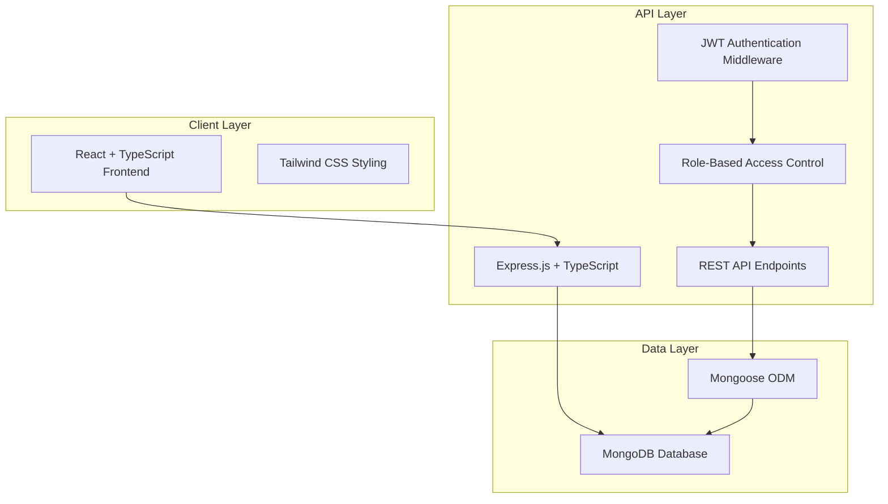

# School Management System - Design Document

## Overview

The School Management System is a full-stack web application built using the MERN stack with TypeScript. The system follows a three-tier architecture with a React frontend, Express.js backend API, and MongoDB database. The application implements role-based access control (RBAC) with JWT authentication to serve three distinct user types: Admins, Teachers, and Students/Parents.

## Architecture

### High-Level Architecture



### Technology Stack

- **Frontend**: React 18+ with TypeScript, Tailwind CSS for styling
- **Backend**: Node.js with Express.js and TypeScript
- **Database**: MongoDB with Mongoose ODM
- **Authentication**: JWT (JSON Web Tokens)
- **State Management**: React Context API with useReducer
- **HTTP Client**: Axios for API communication
- **Build Tools**: Vite for frontend, ts-node for backend development

## Components and Interfaces

### Frontend Architecture

#### Component Structure
```
src/
├── components/
│   ├── common/           # Reusable UI components
│   ├── admin/           # Admin-specific components
│   ├── teacher/         # Teacher-specific components
│   └── student/         # Student/Parent components
├── pages/               # Route-level components
├── hooks/               # Custom React hooks
├── context/             # React Context providers
├── services/            # API service functions
├── types/               # TypeScript type definitions
└── utils/               # Utility functions
```

#### Key Frontend Components

1. **Authentication Components**
   - `LoginForm`: Handles user authentication
   - `ProtectedRoute`: Route wrapper for authenticated access
   - `RoleGuard`: Component-level role-based access control

2. **Admin Dashboard Components**
   - `StudentManagement`: CRUD operations for students
   - `TeacherManagement`: Teacher assignment and management
   - `TimetableBuilder`: Interactive timetable creation
   - `ReportsGenerator`: Comprehensive reporting interface

3. **Teacher Dashboard Components**
   - `AttendanceMarker`: Subject-wise attendance marking
   - `ClassSchedule`: Teacher's timetable view
   - `LeaveApplication`: Leave request submission

4. **Student/Parent Components**
   - `AttendanceViewer`: Personal attendance history
   - `ReportCard`: Academic performance display
   - `PaymentStatus`: Fee payment tracking

### Backend Architecture

#### API Structure
```
src/
├── controllers/         # Request handlers
├── middleware/          # Authentication & validation
├── models/             # Mongoose schemas
├── routes/             # API route definitions
├── services/           # Business logic layer
├── utils/              # Helper functions
└── types/              # TypeScript interfaces
```

#### Core API Endpoints

1. **Authentication Routes** (`/api/auth`)
   - `POST /login` - User authentication
   - `POST /refresh` - Token refresh
   - `POST /logout` - Session termination

2. **Student Management** (`/api/students`)
   - `GET /` - List students (with filtering)
   - `POST /` - Create new student
   - `PUT /:id` - Update student details
   - `DELETE /:id` - Archive student

3. **Teacher Management** (`/api/teachers`)
   - `GET /` - List teachers
   - `POST /` - Add new teacher
   - `PUT /:id/assignments` - Update class assignments

4. **Attendance Management** (`/api/attendance`)
   - `POST /mark` - Mark attendance
   - `GET /student/:id` - Get student attendance
   - `GET /class/:classId/subject/:subjectId` - Class attendance

5. **Timetable Management** (`/api/timetable`)
   - `GET /class/:classId` - Get class timetable
   - `POST /` - Create/update timetable
   - `GET /teacher/:teacherId` - Teacher schedule

## Data Models

### User Schema
```typescript
interface User {
  _id: ObjectId;
  email: string;
  password: string; // hashed
  role: 'admin' | 'teacher' | 'student' | 'parent';
  profile: AdminProfile | TeacherProfile | StudentProfile | ParentProfile;
  isActive: boolean;
  createdAt: Date;
  updatedAt: Date;
}
```

### Student Schema
```typescript
interface Student {
  _id: ObjectId;
  rollNo: string;
  name: string;
  dateOfBirth: Date;
  admissionDate: Date;
  standard: string;
  section: string;
  parentContact: {
    fatherName: string;
    motherName: string;
    phone: string;
    email: string;
    address: string;
  };
  status: 'active' | 'left';
  leavingDate?: Date;
  userId: ObjectId; // Reference to User
}
```

### Teacher Schema
```typescript
interface Teacher {
  _id: ObjectId;
  employeeId: string;
  name: string;
  subjects: string[];
  assignedClasses: {
    standard: string;
    section: string;
    subject: string;
  }[];
  salary: {
    amount: number;
    status: 'paid' | 'unpaid';
    lastPaidDate?: Date;
  };
  userId: ObjectId; // Reference to User
}
```

### Attendance Schema
```typescript
interface Attendance {
  _id: ObjectId;
  studentId: ObjectId;
  teacherId: ObjectId;
  classId: ObjectId;
  subject: string;
  date: Date;
  status: 'present' | 'absent' | 'late';
  markedAt: Date;
  academicYear: string;
}
```

### Timetable Schema
```typescript
interface Timetable {
  _id: ObjectId;
  classId: ObjectId;
  academicYear: string;
  schedule: {
    day: 'monday' | 'tuesday' | 'wednesday' | 'thursday' | 'friday';
    periods: {
      slot: string; // A1, B1, C1, etc.
      subject: string;
      teacherId: ObjectId;
      startTime: string;
      endTime: string;
    }[];
  }[];
}
```

### Exam Schema
```typescript
interface Exam {
  _id: ObjectId;
  name: string;
  academicYear: string;
  subjects: {
    subject: string;
    date: Date;
    syllabus: string;
    maxMarks: number;
  }[];
  results: {
    studentId: ObjectId;
    marks: {
      subject: string;
      marksObtained: number;
      grade: string;
    }[];
  }[];
}
```

## Error Handling

### Frontend Error Handling
- **API Error Interceptor**: Axios interceptor to handle common HTTP errors
- **Error Boundary**: React error boundaries for component-level error catching
- **Toast Notifications**: User-friendly error messages using react-hot-toast
- **Form Validation**: Client-side validation with react-hook-form and zod

### Backend Error Handling
- **Global Error Middleware**: Centralized error handling for all routes
- **Custom Error Classes**: Structured error responses with appropriate HTTP status codes
- **Validation Middleware**: Request validation using express-validator
- **Database Error Handling**: Mongoose error transformation and logging

```typescript
// Custom Error Classes
class AppError extends Error {
  statusCode: number;
  isOperational: boolean;
  
  constructor(message: string, statusCode: number) {
    super(message);
    this.statusCode = statusCode;
    this.isOperational = true;
  }
}

// Global Error Handler
const globalErrorHandler = (err: AppError, req: Request, res: Response, next: NextFunction) => {
  const { statusCode = 500, message } = err;
  
  res.status(statusCode).json({
    status: 'error',
    message,
    ...(process.env.NODE_ENV === 'development' && { stack: err.stack })
  });
};
```

## Testing Strategy

### Frontend Testing
- **Unit Tests**: Jest + React Testing Library for component testing
- **Integration Tests**: Testing user workflows and API integration
- **E2E Tests**: Cypress for critical user journeys
- **Accessibility Tests**: axe-core integration for WCAG compliance

### Backend Testing
- **Unit Tests**: Jest for service and utility function testing
- **Integration Tests**: Supertest for API endpoint testing
- **Database Tests**: MongoDB Memory Server for isolated database testing
- **Authentication Tests**: JWT token validation and role-based access testing

### Test Coverage Goals
- Minimum 80% code coverage for critical business logic
- 100% coverage for authentication and authorization flows
- Integration tests for all API endpoints
- E2E tests for primary user workflows (attendance marking, report generation)

### Testing Environment Setup
```typescript
// Test Database Configuration
const testDbConfig = {
  mongoUri: process.env.TEST_MONGO_URI || 'mongodb://localhost:27017/sms_test',
  options: {
    useNewUrlParser: true,
    useUnifiedTopology: true,
  }
};

// Test User Factory
const createTestUser = (role: UserRole) => ({
  email: `test-${role}@example.com`,
  password: 'hashedPassword',
  role,
  isActive: true
});
```

## Security Considerations

### Authentication & Authorization
- **JWT Implementation**: Secure token generation with appropriate expiration
- **Password Security**: bcrypt hashing with salt rounds
- **Role-Based Access Control**: Middleware-based permission checking
- **Session Management**: Refresh token rotation and secure logout

### Data Protection
- **Input Validation**: Comprehensive request validation and sanitization
- **SQL Injection Prevention**: Mongoose ODM provides built-in protection
- **XSS Protection**: Content Security Policy headers and input sanitization
- **CORS Configuration**: Restricted cross-origin requests

### API Security
- **Rate Limiting**: Express rate limiter to prevent abuse
- **Request Size Limits**: Body parser limits for file uploads
- **Security Headers**: Helmet.js for security headers
- **Environment Variables**: Secure configuration management

## Performance Optimization

### Frontend Optimization
- **Code Splitting**: React.lazy for route-based code splitting
- **Memoization**: React.memo and useMemo for expensive computations
- **Virtual Scrolling**: For large data lists (student/teacher lists)
- **Image Optimization**: Lazy loading and responsive images

### Backend Optimization
- **Database Indexing**: Strategic indexes on frequently queried fields
- **Query Optimization**: Mongoose populate optimization and field selection
- **Caching Strategy**: Redis for session storage and frequently accessed data
- **Pagination**: Cursor-based pagination for large datasets

### Database Design
```typescript
// Strategic Indexes
const studentIndexes = [
  { rollNo: 1, standard: 1, section: 1 }, // Unique compound index
  { standard: 1, section: 1 }, // Class-based queries
  { status: 1, admissionDate: -1 } // Status and date filtering
];

const attendanceIndexes = [
  { studentId: 1, date: -1 }, // Student attendance history
  { classId: 1, subject: 1, date: -1 }, // Class attendance reports
  { teacherId: 1, date: -1 } // Teacher attendance tracking
];
```

This design provides a robust, scalable foundation for the School Management System while maintaining security, performance, and maintainability standards.